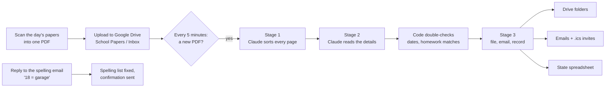

# School Paper Organizer

Every day a first grader comes home with a stack of papers: worksheets, graded
tests, the weekly homework sheet, the spelling list, flyers about picture day
and the Thanksgiving feast. **School Paper Organizer** turns a scan of that stack
into something useful:

- **Every page sorted** into folders: the homework sheet, tonight's homework,
  spelling sheets, flyers, and a folder per subject (Math, Grammar, Logic, …).
- **Calendar invites** for school events and upcoming tests, emailed as `.ics`
  files that open straight into a phone's calendar, sent once per event even
  when the same event is mentioned on several papers.
- **This week's spelling words** in an email and a text file, with the words
  marked wrong flagged for practice. Words the AI couldn't read are shown as
  `???`. Reply `18 = garage` and the list is fixed, with a confirmation in the
  same email thread.
- **Tonight's real homework**: worksheets that match today's line on the
  weekly homework sheet, as opposed to old homework that was graded and
  sent back, or in-class practice pages that look identical.

You scan the stack, upload one PDF, and a few minutes later the emails arrive.

---

## How it works



**Stage 1: sort every page.** Claude looks at the whole PDF and puts each page
into one of six categories: `homework_sheet` (the weekly grid),
`spelling_word_sheet`, `informational_flyer`, `school_work`, `other` or
`unknown`. It also reads each page's title, its small printed worksheet code
(for example `..._G1_WS55`) and its subject. This stage is not allowed to
decide that something is "homework". That needs the weekly sheet, which may
come later in the same stack.

**Stage 2: read the details.** One focused request per job:
- **Weekly homework sheet:** the assignments for each weekday, this week's and
  next week's tests, notes, and events.
- **Flyers:** calendar-worthy events, filtered to this student's grade and
  class (a flyer with different times per grade only gives this child's).
- **Spelling sheets:** each word as the student wrote it, the teacher's
  correction, and whether it was marked wrong.
- **Homework matching:** each remaining worksheet is compared with *today's*
  assignments on the weekly sheet. Pages that were already completed and
  corrected, or say "Class Practice" instead of "Homework", don't count.

**The code double-checks the AI.** The AI is good but not perfect, so plain
code checks every answer that matters:
- A "this is homework" answer is **overruled** when the page's worksheet code
  names a different worksheet (`MF55` is not `WS 55`), or when the page is
  workbook page 106 and the assignment says page 105.
- Test dates are **worked out by code**, not guessed: Monday of the week
  printed on the sheet, plus the weekday column the test sits in.
- An event with no printed year gets the **coming** date, not one from two
  years ago.
- The homework sheet used is the one for **the scan's own week**. Next week's
  sheet often comes home on Friday.
- An event already emailed is recognized even when **worded differently**
  ("Dress Up Day" vs "Halloween Dress-Up Day"), so you don't get it twice.
- A spelling list that matches one from the last two weeks is the
  **end-of-week test** of the same words. It's filed with no email.

**Stage 3: file, email, record.** The pages are split into separate PDFs in
Drive, the emails go out, and everything is recorded in a Google Sheet, so a
re-uploaded scan is recognized and nothing is sent twice.

### What you end up with in Google Drive

```
School Papers/
├── Inbox/                    ← upload scans here (never changed or moved)
├── Original Scans/           ← an untouched copy of each scan
├── Homework Sheets/          ← the weekly homework grid
├── Homework/                 ← tonight's actual homework
├── Spelling Sheets/          ← pre-tests and final tests
├── Spelling Words/           ← 11-02-2026-spelling-words.txt, …
├── Informational Flyers/     ← one PDF per flyer, named after it
├── Subjects/
│   ├── Math/  Grammar/  Spelling/  Logic/  Geography/  …
├── Results/                  ← the full analysis of each scan (JSON)
└── School Paper Organizer State   (Google Sheet)
```

---

## Technology

| Part | What's used |
|---|---|
| Runs on | **Google Apps Script** (JavaScript, V8 runtime), on a 5-minute time-driven trigger. No server to run. |
| AI | **Claude API** (Anthropic), model `claude-sonnet-5-5`. The PDF is sent as a document block, and every answer comes back as **structured JSON**: `output_config.format` with a JSON schema, so replies always have the expected shape. |
| Storage | **Google Drive** (`DriveApp`) for scans and output; a **Google Sheet** (`SpreadsheetApp`) as the database (scans, known events, spelling lists, homework, log). |
| Email | **Gmail** (`MailApp` for notices; `GmailApp` drafts for spelling emails, so replies can be matched to them). |
| Calendar | Plain **iCalendar (.ics)** files built in code (`Ics.gs`): all-day or timed, `America/Los_Angeles`. |
| PDF splitting | Apps Script can't split PDFs, so an optional small **Cloud Run** service does it (`PDF_SPLITTER_URL`). Without it everything else still works. |
| Deploying | **clasp** (Google's command-line tool for Apps Script). |
| Tests | **Node.js**: `apps-script/tests/run-tests.js` runs the real `.gs` code against small fakes of Sheets, Drive and Gmail, with no network. |

**Cost:** about 50–75 cents per 20-page scan at Claude Sonnet 5.5 prices
($2 / $10 per million input / output tokens), because the PDF is sent once per
step (4–5 requests).

**Safety:** scanned pages are treated as untrusted. Every prompt starts with a
rule that text on a paper is never an instruction (`Prompt.gs`). A broken or
wrong file is reported once by email and not retried, so it can't keep
costing money. A bad API key or an empty credit balance is reported at most
once a day, and scans simply wait until it's fixed.

---

## The two versions

This repository holds two separate implementations that share no code.

| Folder | What it is | Status |
|---|---|---|
| [`apps-script/`](apps-script/README.md) | **Google Apps Script + Claude API.** The version described above. | **In use** |
| [`local/`](local/README.md) | **Local AI version.** Python on a Windows PC with an NVIDIA GPU. Pages are read by a vision model running on the PC (**Ollama** + **Qwen2.5-VL 32B**), so scans never go to an AI service. | Retired, kept for reference |

The project started on Apps Script and moved to the local version for privacy
and cost. Running locally taught a lot: the page-number and worksheet-ID
checks, the spelling reply loop, and final-test detection were all built
there. In the end the cloud version was more practical: faster, more
accurate, and nothing to keep running at home. Everything learned locally
was ported back.

The local version's stack, for the curious: Python 3.12, Ollama
(`qwen2.5vl:32b`, one page per request at 200 DPI), PyMuPDF for rendering and
splitting, NumPy to find the homework sheet's table lines (so each test is
read from its own box), SQLite for state, SMTP/IMAP to Gmail with the password
in Windows Credential Manager, Google Drive for desktop for syncing, and
Windows Task Scheduler to keep a folder watcher running. On an RTX 4090 it
sorted about 97% of pages correctly at roughly 17–65 seconds per page.

---

## Setting it up yourself

You need a Google account, an [Anthropic API key](https://console.anthropic.com/),
and Node.js (for clasp).

1. Install clasp and sign in. Turn on the **Google Apps Script API** at
   https://script.google.com/home/usersettings first.
   ```bash
   npm install -g @google/clasp
   clasp login
   ```
2. From the `apps-script` folder, create a project (or `clasp clone <scriptId>`
   an existing one) and upload the code:
   ```bash
   clasp create --type standalone --title "School Paper Organizer"
   clasp push
   ```
3. In the Apps Script editor, go to **Project Settings → Script Properties**
   and add `ANTHROPIC_API_KEY` and `NOTIFICATION_EMAIL`. Optional properties
   are `STUDENT_GRADE`, `STUDENT_CLASS`, `ANTHROPIC_MODEL` and
   `PDF_SPLITTER_URL`.
4. Run **`setupProject`** once. It creates the Drive folders and the state
   sheet, and asks for permissions.
5. Run **`installInboxTrigger`** once.
6. Upload a scan to `School Papers/Inbox`.

Tip: name scans with the date (`11-03-2026.pdf`). The date in the name is the
date the papers are filed under.

More detail, including the state sheet, manual tools like
`forceReprocessFile`, and design notes, is in
[`apps-script/README.md`](apps-script/README.md).

Run the tests:

```bash
node apps-script/tests/run-tests.js
```

---

## Privacy

Scans contain a child's name, handwriting and schoolwork. This repository
contains **no scans and no personal data**. PDFs, analysis results, local
state and account-specific files are excluded by `.gitignore`. The test data
is made up.
